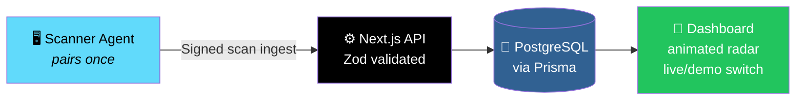
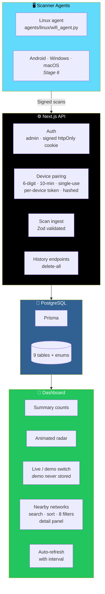

# 📡 WiFi Radar (Stages 1–2)

<div align="center">


**A web dashboard + API for Wi-Fi discovery.**

*Scan from a paired scanner agent. The web app only displays what agents report.*

[🚀 Run](#-run) • [🛰️ Connect a Scanner](#-connect-a-real-scanner-linux) • [✅ What Works](#-what-works-in-this-build) • [⚠️ What's Not Built](#-not-built-yet-by-stage) • [🚧 Honest Limits](#-honest-limits)

</div>

---

## 📖 Overview

**WiFi Radar** is a **web dashboard + API for Wi-Fi discovery**.

### The Core Constraint

> **A browser CANNOT scan Wi-Fi.**
>
> **So scans come from a paired *scanner agent*** — **and the web app only displays what agents report.**

### Core Idea

> **Demo mode is clearly labelled — and never stored.**

### The Architecture



---

## ✅ What Works in This Build

<div align="center">

| 🔐 Auth & Pairing | 📥 Ingest API |
|:---:|:---:|
| **Single admin** from `.env` · **signed httpOnly cookie** · **device pairing** *(6-digit, 10-minute, single-use code → per-device token, stored hashed)* | **Zod-validated** scan ingest API → **Postgres via Prisma** — **all 9 requested tables + enums** |
| **📊 Dashboard** | **📶 Nearby Networks** |
| **Summary counts** · **animated radar** · **live/demo switch** · **scan states** · **auto-refresh with interval** | **Search** · **sort** · **8 filters** · **detail panel** *(BSSID · dBm/% · band · channel · security · first/last seen)* |
| **🗑️ History** | **📱 PWA & Docker** |
| **Delete-all-history endpoint** | **PWA manifest** · **Docker** · **Linux agent** *(`agents/linux/wifi_agent.py`)* |

</div>

---

## ⚠️ Not Built Yet *(by Stage)*

> **Disabled nav items say "soon".**
>
> **Distance is NEVER estimated — and AP locations are all `UNKNOWN` until a provider exists.**

<div align="center">

| Stage | Not Built |
|:-----:|-----------|
| **4** | Map + AP geolocation providers |
| **5** | Analytics charts & signal-history graph |
| **—** | Scan history & settings pages |
| **—** | **WebSocket push** — *the UI polls for now* |
| **6** | Android / Windows / macOS scanners |
| **—** | Rate limiting |
| **—** | Tests |
| **7** | Service worker / icons |

</div>

---

## 🚀 Run

### Setup

```bash
cp .env.example .env        # set SESSION_SECRET (openssl rand -hex 32), ADMIN_EMAIL, ADMIN_PASSWORD
docker compose up -d db
npm install
npx prisma migrate dev --name init   # creates the migration (needs internet for Prisma engines)
npm run dev                          # http://localhost:3000
```

### ⚠️ Port Conflict Note

> **If another local service already uses port `5432`**, set **`DB_PORT=5433`** in `.env` and update **`DATABASE_URL`** to use **port `5433`**.

### 🐳 Or Everything in Docker

```bash
docker compose up --build
```

> 💡 **Uses `db push` until you've committed a migration.**

---

## 🛰️ Connect a Real Scanner *(Linux)*

### 1. Sign In

Sign in at **`/login`**.

### 2. Get a Pairing Code

```bash
curl -b cookiejar -X POST localhost:3000/api/v1/devices/pair-code
```

> 💡 **A Settings UI for this is planned.**

### 3. Pair the Agent

```bash
python3 agents/linux/wifi_agent.py pair --server http://localhost:3000 --code 123456
```

### 4. Start Scanning

```bash
python3 agents/linux/wifi_agent.py run --interval 30
```

---

## 🚧 Honest Limits

> **These are constraints of the platform, not of the app.**

<div align="center">

| Platform / Feature | Limit |
|:------------------:|-------|
| **🤖 Android** | **Throttles scans** *(~4 per 2 minutes foreground)* |
| **🍎 iOS** | **No public nearby-scan API** |
| **🖥️ macOS** | **Hides SSIDs without Location permission** |
| **📡 Radar distance** | **= signal strength only** |
| **🧭 Radar direction** | **Arbitrary** |

</div>

### ⚠️ Not Verified in This Build

> **Couldn't run `next build` offline.**
>
> **Run `npm run typecheck` after `prisma generate`.**

---

## 🏗️ Architecture

### System Overview



### Design Principles

<div align="center">

| Principle | Implementation |
|-----------|---------------|
| **🛰️ Scans come from agents** | **A browser cannot scan Wi-Fi** — the web app **only displays what agents report** |
| **🎭 Demo mode is honest** | **Clearly labelled — and never stored** |
| **🔐 Pairing is a real handshake** | **6-digit code · 10-minute expiry · single-use** → **per-device token, stored hashed** |
| **🛡️ Ingest is validated** | **Zod validates every scan payload** before it reaches Prisma |
| **📍 No fake precision** | **Distance is NEVER estimated** · **AP locations are all `UNKNOWN` until a provider exists** |
| **🖥️ Agent is included** | **A working Linux agent ships with the project** — not just documentation |
| **🚫 Honest about scope** | **Disabled nav items say "soon"** · **"Not built yet" is organized by stage** |

</div>

### 📚 API Docs

> 📖 **See [`docs/API.md`](docs/API.md).**

---

## 🗺️ Roadmap

### ✅ Stages 1–2 — Current

- [x] Next.js foundation with TypeScript and Prisma
- [x] PostgreSQL database with all 9 requested tables and enums
- [x] Single-admin auth from `.env` with signed httpOnly cookie
- [x] Device pairing — 6-digit code, 10-minute expiry, single-use
- [x] Per-device token stored hashed
- [x] Zod-validated scan ingest API
- [x] Dashboard with summary counts
- [x] Animated radar visualization
- [x] Live/demo switch with demo clearly labelled and never stored
- [x] Scan state indicators
- [x] Auto-refresh with configurable interval
- [x] Nearby networks view with search, sort, and 8 filters
- [x] Detail panel with BSSID, dBm/percentage, band, channel, security, first/last seen
- [x] Delete-all-history endpoint
- [x] PWA manifest
- [x] Docker and Docker Compose setup
- [x] Linux scanner agent — pair and run commands
- [x] `docs/API.md` API reference

### 🔜 Stage 4

- [ ] **Map** — visualize reported APs on a map
- [ ] **AP geolocation providers** — currently all locations are `UNKNOWN`

### 🔜 Stage 5

- [ ] **Analytics charts**
- [ ] **Signal-history graph**

### 🔜 Stage 6

- [ ] **Android scanner**
- [ ] **Windows scanner**
- [ ] **macOS scanner**

### 🔜 Stage 7

- [ ] **Service worker**
- [ ] **Icons**

### 🔜 Unstaged

- [ ] **Scan history page**
- [ ] **Settings page** — including the pairing-code UI
- [ ] **WebSocket push** — replacing polling
- [ ] **Rate limiting**
- [ ] **Tests**
- [ ] **Verified `next build`**

---

## 🤝 Contributing

Contributions are welcome. Please:

1. Fork the repository
2. **Keep the browser constraint honest** — the web app must never pretend it can scan Wi-Fi
3. **Keep demo mode clearly labelled** — and never stored
4. **Validate every ingest payload** with Zod before it reaches Prisma
5. **Never estimate distance** — signal strength only, and say so
6. **Never invent AP locations** — `UNKNOWN` until a real provider exists
7. **Keep pairing single-use and expiring**
8. **Store device tokens hashed**
9. **Update `docs/API.md`** for any API change
10. Submit a Pull Request

### Guidelines

- **Never claim a feature is built** when the roadmap says otherwise
- **Never store demo data** in the database
- **Never log device tokens** — even in error messages
- **Never bypass `SESSION_SECRET` or auth checks**
- **Never present an estimate as a measurement**

---

## 📜 License

MIT — see [LICENSE](LICENSE) for details.

---

## 🙏 Acknowledgments

- **Every scanner agent that ever did the hard work in the background** — this one's for you
- **The `iw` and `nmcli` Linux tools** — for making Wi-Fi scans scriptable

---

<div align="center">

### 📡 PAIR. SCAN. REPORT. VISUALIZE.

**A web dashboard + API for Wi-Fi discovery.**

**The browser can't scan — so a real agent does.**

<br>

> ⚠️ **Not yet verified: `next build` could not run offline. Run `npm run typecheck` after `prisma generate`.**

<br>

⭐ If WiFi Radar helped you, consider giving it a star.

<br>

[⬆ Back to Top](#-wifi-radar-stages-12)

</div>
